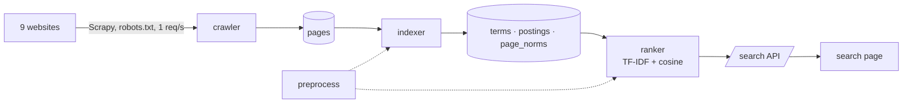

# IRIS – Intelligent Information Retrieval System

**Intelligent Information Retrieval System with Web Crawling and Ranking Algorithms** – a small but complete
search engine built as our ENGI 401/402 capstone project at Cyprus International University, Faculty of Engineering.
It crawls nine websites, cleans and indexes their text, and ranks results with TF-IDF and cosine similarity.

Supervisor: **Asst. Prof. Dr. Tolga Yırtıcı** · Term: 2026/2027 Fall

## Team

| Member | Department | Role | Modules |
| --- | --- | --- | --- |
| Mohammed Nouri | Computer Engineering | Team leader · Crawler & Infrastructure | `crawler/`, `run_pipeline.py`, database |
| Yazen Alhuri | Artificial Intelligence Engineering | AI Engineer · Pre-processing & Ranking | `preprocessing/`, `ranker/` |
| Hani Abu Kwaik | Software Engineering | Software Engineer #1 · Indexer & API | `indexer/`, `/search` API |
| Elpi Kipoyi Ndonganani | Software Engineering | Software Engineer #2 · Interface, Testing & Scrum | `web/`, tests, meeting notes |

## How it works



The names, table columns and JSON format that connect the modules are fixed in
**[docs/contracts.md](docs/contracts.md)**.

## Status

| Module | Owner | Status |
| --- | --- | --- |
| Crawler – 9 sites, cleaning, duplicates, incremental re-crawl | Mohammed | ✅ Done – **3,769 pages, 6.46 million words** ([crawl report](docs/crawl-report.md)) |
| Shared database (Supabase PostgreSQL) | Mohammed | ✅ Done |
| Search page and results page | Elpi | ✅ Done with sample results |
| `preprocess(text)` | Yazen | ⏳ Due 29 Oct |
| Indexer `python3 -m indexer.build` | Hani | ⏳ Due 30 Oct |
| `rank(query, k)` | Yazen | ⏳ Due 30 Oct |
| `GET /search` JSON API | Hani | ⏳ Due 31 Oct |
| Real results on the page, tests in GitHub Actions | Elpi | ⏳ Due 1 Nov |

## Roadmap

| Week | Dates | Goal | State |
| --- | --- | --- | --- |
| 1 | 5–11 Oct | Repository, roles, seed sites, robots.txt check, test spider | ✅ |
| 2 | 12–18 Oct | Full crawler and storage (1,360 pages); module contracts; search page | ✅ |
| 3 | 19–25 Oct | Incremental re-crawl, 9 sites (3,769 pages), shared cloud database | ✅ |
| 4 | 26 Oct – 1 Nov | **Milestone: first end-to-end search** – pre-processing, index, ranking, API, deployment | ⏳ Current week |
| 5 | 2–8 Nov | Better ranking (title boost) and interface; speed under 1 s per query | ⏳ |
| 6 | 9–15 Nov | Evaluation of the 20 test queries (precision of the top 10 results) | ⏳ |
| 7 | 16–22 Nov | Testing, fixes, final demo preparation | ⏳ |
| 8 | 23–29 Nov | Final report and presentation | ⏳ |

## Repository structure

```
IRIS-Search-Engine/
├── crawler/          web crawler (Scrapy), cleaning, duplicates, storage, crawl report
├── preprocessing/    preprocess(text): tokens, stop words, stemming
├── indexer/          inverted index builder (terms, postings, page_norms)
├── ranker/           rank(query, k): TF-IDF + cosine similarity
├── web/              Flask app: search page, results page, /search API
├── tests/            pytest tests for every module
├── docs/             requirements, contracts, reports, meeting notes
│   ├── report/       draft sections of the final report
│   └── weekly/       weekly submission notes
├── run_pipeline.py   robots check → crawl → report → index, in one command
└── requirements.txt
```

## Getting started

```bash
git clone https://github.com/22302754/IRIS-Search-Engine.git
cd IRIS-Search-Engine
python3 -m pip install -r requirements.txt
python3 -m pytest
```

Put the shared database connection (sent to you privately by Mohammed) in a `.env` file in the repository root.
Never commit it and never post it in the group.

```
DATABASE_URL=postgresql://...
```

| Command | What it does |
| --- | --- |
| `python3 run_pipeline.py` | robots.txt check → crawl → crawl report → index |
| `python3 -m crawler.load_jsonl crawler/output/pages.jsonl` | Load a crawl file into the database without crawling |
| `python3 -m flask --app web.app run --port 8000` | Run the web app at `http://localhost:8000` |

## Documents

| Document | What it is |
| --- | --- |
| [docs/requirement.md](docs/requirement.md) | Functional and non-functional requirements |
| [docs/contracts.md](docs/contracts.md) | How the modules connect |
| [docs/meeting-notes.md](docs/meeting-notes.md) | Decisions log and meeting notes |
| [docs/seed-sites.md](docs/seed-sites.md) | The crawled sites and their robots.txt check |
| [docs/crawl-report.md](docs/crawl-report.md) | Numbers from the latest crawl |
| [docs/cloud-database.md](docs/cloud-database.md) | The shared Supabase database |
| [docs/report/](docs/report/) | Draft sections of the final report |
| [docs/weekly/](docs/weekly/) | Weekly submission notes |
| [crawler/README.md](crawler/README.md) | How to run the crawler |

## How we work

1. Every task is a GitHub issue, assigned to one person, in a weekly milestone.
2. Work on a branch (`git checkout -b indexer-build`), never directly on `main`.
3. Run `python3 -m pytest` before pushing.
4. Open a pull request, link the issue, and ask one teammate to review.
5. Merge after the review; the branch is deleted after merging.
